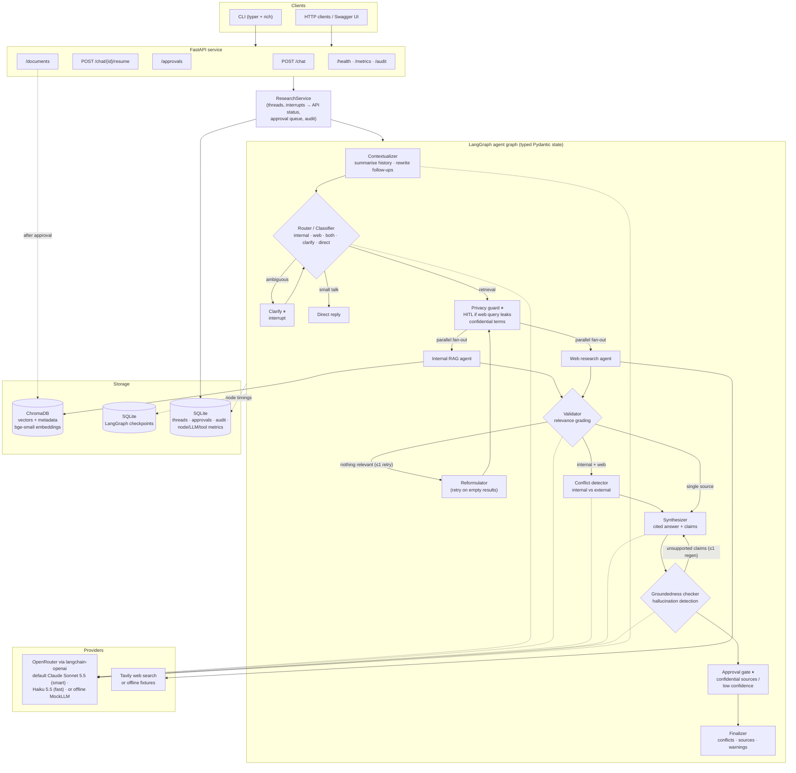
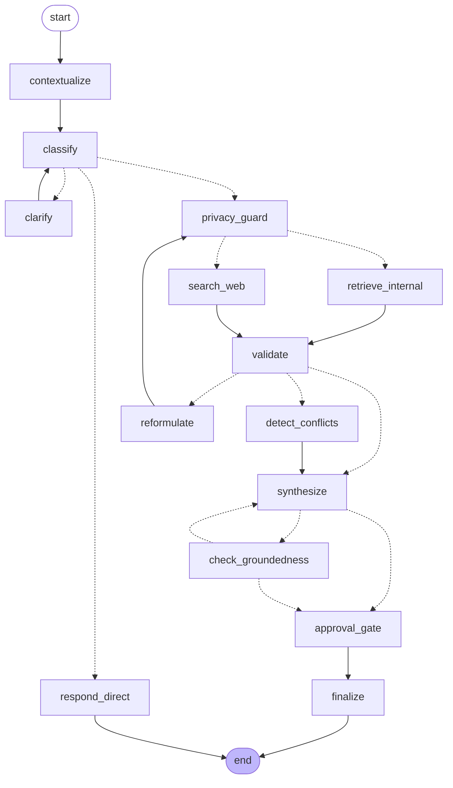

# Architecture

## System overview

The diagram source is in [`architecture.mmd`](architecture.mmd). The compiled LangGraph is exported verbatim from code (`graph.get_graph().draw_mermaid()`) to [`graph.mmd`](graph.mmd):

Dotted edges are **conditional routes**; `privacy_guard → {retrieve_internal, search_web}` is a **parallel fan-out** (both run in the same superstep when the route is `both`, and `validate` joins them).

To export PNGs: `npx @mermaid-js/mermaid-cli -i docs/architecture.mmd -o docs/architecture.png -w 1600 -b white`.

## Agents

| Node                   | Role                                                                                                                                                                                                                                                                                           | Model tier | Failure behaviour                                               |
| ---------------------- | ---------------------------------------------------------------------------------------------------------------------------------------------------------------------------------------------------------------------------------------------------------------------------------------------- | ---------- | --------------------------------------------------------------- |
| `contextualize`      | Summarises long histories (keeps last N messages + running summary) and rewrites follow-ups ("what about it?") into standalone questions                                                                                                                                                       | fast       | falls back to the raw message + warning                         |
| `classify`           | Routes to `internal` / `web` / `both` / `clarify` / `direct`; writes separate internal and web queries (the web query must not contain confidential names)                                                                                                                           | fast       | **fails open** to `both` + warning                      |
| `clarify`            | `interrupt()`s with one specific question; on resume merges the answer and re-classifies (max 2 per turn)                                                                                                                                                                                    | –         | –                                                              |
| `privacy_guard`      | Scans the outgoing web query for confidential terms (declared in confidential docs' front-matter + config); `interrupt()`s for approval. Rejection skips the web and falls back to internal                                                                                                  | –         | –                                                              |
| `retrieve_internal`  | ChromaDB similarity search (cosine, top-k chunks with doc metadata, classification and date)                                                                                                                                                                                                   | –         | retried with backoff; on exhaustion returns empty + warning     |
| `search_web`         | Tavily search (advanced depth)                                                                                                                                                                                                                                                                 | –         | retried with backoff; outage, so internal-only answer + warning |
| `validate`           | Merges and dedupes evidence, assigns citation ids `S1..Sn`, grades relevance and drops off-topic passages                                                                                                                                                                                    | fast       | falls back to similarity-score threshold                        |
| `reformulate`        | When nothing relevant was found, rewrites the queries (synonyms, broader terms) and loops back (max 1 retry)                                                                                                                                                                                   | fast       | reuses original query                                           |
| `detect_conflicts`   | Compares internal vs external evidence; returns structured conflicts with source ids on both sides and which side is likely current (uses document dates)                                                                                                                                      | smart      | skipped + warning                                               |
| `synthesize`         | Writes the markdown answer using **only** the evidence; every factual sentence carries `[Sx]` markers; lists atomic claims with supporting ids; reports gaps and confidence. Unknown citation ids are stripped. With no evidence it **abstains deterministically** (no LLM call) | smart      | extractive fallback answer, confidence capped at 0.4, + warning |
| `check_groundedness` | Deterministic check (each claim must cite something) + LLM verification of each claim against its cited text. Unsupported claims are fed back to `synthesize` for one regeneration                                                                                                           | fast       | score 0.5 + warning                                             |
| `approval_gate`      | `interrupt()`s when the answer cites **confidential** documents or confidence/groundedness is below threshold. Rejection withholds the answer                                                                                                                                          | –         | –                                                              |
| `finalize`           | Appends the structured conflicts section, unverified-claim warnings, gaps and the source list; stores the assistant message                                                                                                                                                                    | –         | –                                                              |

## State management

`ResearchState` (`graph/state.py`) is a Pydantic model used directly as the LangGraph state schema:

- **Conversation-level** fields persist across turns: `messages` (with the `add_messages` reducer, so old messages are removed with `RemoveMessage` when summarised), `summary`, `user_id`.
- **Turn-level** fields (`route`, queries, evidence, draft, groundedness, conflicts...) are reset by `fresh_turn_input()` at every new user message.
- `warnings`, `trace` and `approvals` use a custom `append_or_reset` reducer, so parallel branches can append safely and a new turn can reset them.
- All LLM outputs are typed Pydantic models (`schemas.py`) produced with native JSON-schema structured outputs (`method="json_schema"`, OpenAI `response_format`) through OpenRouter.

Checkpoints are written to SQLite by `SqliteSaver` after every superstep, so a thread paused at an interrupt survives a server restart (see `test_conversation_survives_service_restart`). The serializer is given an explicit allow-list of our Pydantic types.

## Human-in-the-loop

| Approval type                | Trigger                                                  | Mechanism                                  | On reject                                        |
| ---------------------------- | -------------------------------------------------------- | ------------------------------------------ | ------------------------------------------------ |
| `external_search_privacy`  | Web query contains confidential terms                    | graph `interrupt()` in `privacy_guard` | web search skipped, answer from internal sources |
| `confidential_data`        | Answer cites a `classification: confidential` document | graph `interrupt()` in `approval_gate` | answer withheld                                  |
| `low_confidence`           | `confidence < 0.45` or `groundedness < 0.7`          | graph `interrupt()` in `approval_gate` | answer withheld                                  |
| `kb_write` / `kb_delete` | `POST /documents`, `DELETE /documents/{id}`          | approval row in SQLite (no graph)          | nothing changes                                  |

`ResearchService` converts a pending interrupt into `status: pending_approval` with an approval id (derived from the interrupt id, so it's idempotent) and records it in the `approvals` table. A reviewer decides via `POST /approvals/{id}` or `POST /chat/{thread_id}/resume`; the graph resumes with `Command(resume=...)`. Each gate can be switched off with `HITL_*` settings.

## Hallucination and failure handling

- **Evidence-only synthesis** with mandatory citations; unknown citation ids are removed.
- **Groundedness check** of every claim, with regeneration and then visible "could not be verified" warnings.
- **Abstention**: no evidence, so a deterministic "I couldn't find..." answer and no LLM call; an answer with no claims bypasses the approval gate.
- **Empty retrieval**, so query reformulation and retry, then abstention.
- **Retries**: `tenacity` exponential backoff with jitter on every external call (LLM, vector store, web). 4xx errors (except 408/409/429) and model refusals are not retried. Every attempt is recorded in `tool_calls`.
- **Graceful degradation**: each agent has a documented fallback (table above) and surfaces a user-visible `warning`.
- **Recursion guard**: loops are bounded (`max_retrieval_attempts`, `max_synthesis_attempts`, `max_clarifications`, LangGraph `recursion_limit=40`).

## Observability

- `structlog` logs (console or JSON via `LOG_JSON=true`) with `request_id`, `thread_id`, `turn_id`, `user_id` bound through contextvars.
- `@traced_node` records duration and status of every node to `node_runs`; the LLM client records model, purpose, tokens, latency and status to `llm_calls`; retries go to `tool_calls`.
- `GET /metrics` aggregates these. `GET /audit` exposes the audit log (queries, clarifications, approvals, answers).
- Each response includes `trace` (nodes executed) and `latency_ms`.
- **LangSmith**: set `LANGSMITH_TRACING=true` and `LANGSMITH_API_KEY` to get full LangGraph traces with no code changes.

## Evaluation

`python -m research_agent.evaluation` runs a 30-question golden set (`eval/golden_set.json`) covering internal, web, hybrid, conflicting, ambiguous and unanswerable questions:

- **Retrieval** (deterministic): document-level hit@k, recall@k, MRR.
- **Routing accuracy** + confusion matrix.
- **Answer quality** (end-to-end, auto-answering clarifications and auto-approving gates): LLM-as-judge faithfulness, answer relevance, citation quality, completeness; plus groundedness, conflict-detection rate and abstention rate on unanswerable questions.

## Key design decisions

- **Deterministic pipeline + router, not a free-form supervisor.** Easier to test, reason about and diagram; the conditional edges still give the agentic loops (clarify, reformulate, regenerate).
- **Provider abstraction with an offline mock.** Every agent calls `llm.structured(schema, ..., context=...)`. The mock uses `context` to produce heuristic outputs, so the whole system (API, demo, CI tests) runs without API keys, and tests can script failures per agent (`tests/conftest.py::ScriptedLLM`).
- **OpenRouter as the LLM gateway**: one OpenAI-compatible API (`langchain-openai` `ChatOpenAI` with `base_url=https://openrouter.ai/api/v1`) gives access to many providers; swap models with `SMART_MODEL` / `FAST_MODEL`. Requests set `provider.require_parameters=true` so OpenRouter only routes to providers that support JSON-schema structured outputs, send no `temperature` (current Claude models reject non-default sampling params) and no forced `tool_choice`, and can list `OPENROUTER_FALLBACK_MODELS` for server-side model fallback. Refusals and 4xx errors such as 402 (out of credits) are non-retryable; malformed JSON output is retried.
- **Two model tiers**: a fast, cheap model (default Haiku 5.5) for high-volume classification and grading, a stronger one (default Sonnet 5.5) for synthesis and conflict reasoning.
- **Separate internal and web queries** so internal context can be used to search the KB without leaking it externally.
