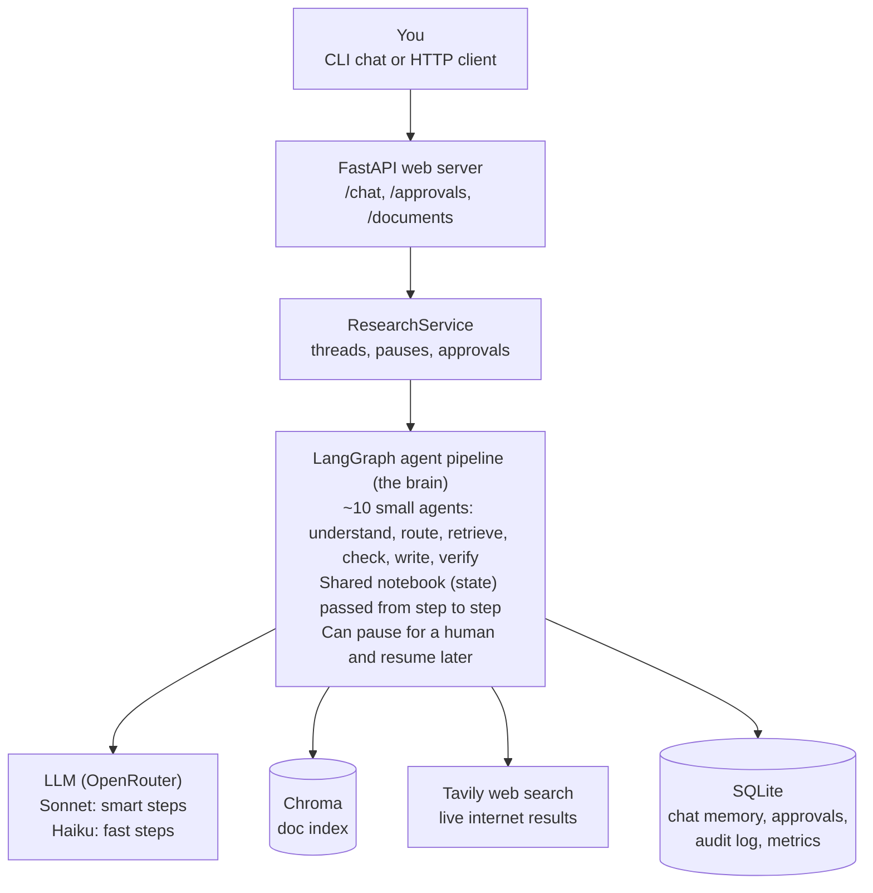
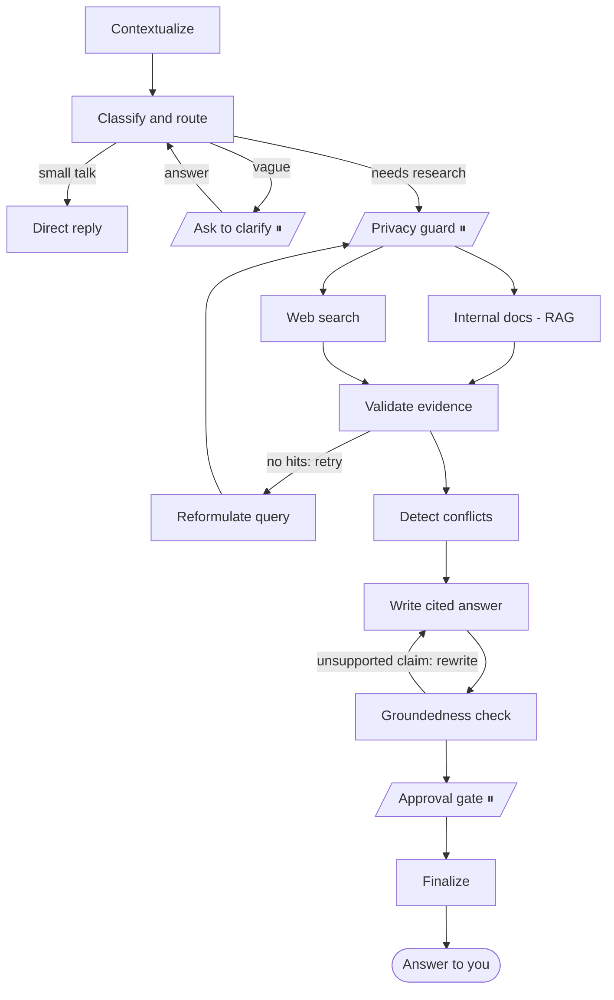

# Enterprise Research Agent — 1000 ft Tutor Guide

As of 2026-11-21. A high-level guide to what this project is and how the agent works end to end.

## 1. What this project is

It is a research assistant for a made-up fintech company, **LedgerLeaf Payments**. Employees ask it questions in plain English. It finds the answer in the company's internal documents, on the web, or in both, and cites a source for every claim.

Think of it as a careful junior analyst who:

- **checks the company wiki first** (21 internal documents: policies, reports, pricing, board minutes)
- **searches the web** when the question needs current, outside information
- **points out disagreements**, for example "our 2025 doc says a competitor charges 2.4%, but a 2026 article says 1.9%"
- **asks a follow-up** when the question is too vague ("What's the limit?" gets the reply "Which limit?")
- **remembers the conversation**, so "And what credits do we get?" makes sense after a question about the SLA
- **asks a human first** before it does anything sensitive, such as using confidential documents or sending an internal project name to a web search engine
- **refuses to make things up**: when it finds no evidence, it says so

One word you will see a lot: it is a **multi-agent** system. That does not mean many chatbots talking to each other. It means one pipeline split into about 10 small, focused steps ("agents"). Each step has one job, and a coordinator decides which step runs next.

It also **runs without any API keys**. With no keys, a built-in offline "fake LLM" and canned web results stand in, so you can try the whole flow on your laptop for free.

## 2. The big picture

The system has four layers. A request enters at the top and the agent pipeline does the thinking. The bottom row holds the outside services and storage that the pipeline calls.



No API keys? A built-in mock LLM and canned web results replace OpenRouter and Tavily.

- **Front door (FastAPI):** a normal web API. You send a question to `POST /chat` and get back an answer with citations, or a status that says "I need more information" or "I need approval".
- **Manager (ResearchService):** tracks each conversation (a *thread*). When the pipeline pauses, it turns the pause into an API status and records approval requests.
- **Brain (LangGraph pipeline):** a flowchart of agents. Each agent reads a shared notebook (the *state*), does its one job, and writes its result back.
- **Tools and storage:** the LLM writes and judges text. Chroma searches the internal documents by meaning. Tavily searches the web. SQLite remembers everything between requests.

## 3. One question, end to end

The question "How do PayNova's current fees compare to our pricing?" passes about ten checkpoints. It is one of the project's demo questions, and it needs both internal documents and the web.



⏸ = can pause and wait for a human, then resume from saved state.

1. **Contextualize.** The agent reads the conversation so far. If you had asked "and theirs?", it would rewrite that into a full, standalone question.
2. **Classify and route.** A fast LLM picks one of five routes: `internal`, `web`, `both`, `clarify` or `direct`. This question gets `both`. The router also writes two separate search queries, one for the internal docs and one for the web.
3. **Privacy guard.** The web query is about to leave the company, so the agent checks it for confidential terms such as "Project Falcon". If it finds one, it pauses for a human. This query is clean, so it continues.
4. **Retrieve, in parallel.** Internal RAG searches Chroma and returns the internal pricing chunks. Web search pulls current articles about PayNova. Both run at the same time.
5. **Validate.** The agent merges the results, drops off-topic passages and numbers the rest as sources `S1`, `S2` and so on. If nothing relevant came back, it rewrites the query and tries once more.
6. **Detect conflicts.** The internal 2025 competitor analysis says PayNova charges 2.4%. A 2026 web article says 1.9%. The agent records this as a conflict and uses the dates to judge which is likely current.
7. **Write the answer.** A smart LLM writes the answer from the evidence only. Every factual sentence carries a `[S#]` citation, and the answer lists its claims one by one.
8. **Groundedness check.** Each claim is checked against the source it cites. An unsupported claim sends the answer back for one rewrite. If the rewrite still fails, the claim gets a visible "could not be verified" warning.
9. **Approval gate.** If the answer uses confidential documents or its confidence is low, it pauses for a reviewer. This answer passes.
10. **Finalize.** The agent adds a conflicts section, the source list and any warnings, saves the message to memory and returns it.

A pause is not a crash. The API replies with `needs_clarification` or `pending_approval`. Everything is saved in SQLite, so the conversation resumes from the same point when someone answers, even after a server restart.

## 4. Meet the agents

Each agent is one small Python function with one job. Most of them call the LLM, but some are plain code. "Fast" agents use a cheaper model (Haiku) for high-volume sorting and grading work. "Smart" agents use a stronger model (Sonnet) for writing and reasoning.

| Agent | Its one job | Model | If it fails |
| --- | --- | --- | --- |
| Contextualizer | Turns follow-ups into standalone questions and summarises long chats | fast | uses your raw message |
| Router / Classifier | Picks the route and writes separate internal and web queries | fast | searches both ("fails open") |
| Clarify | Asks you one specific question, then re-routes | none | at most 2 per turn |
| Privacy guard | Stops confidential names from leaking into web searches | none | reviewer decides |
| Internal RAG | Searches the company docs by meaning | none | retries, then returns nothing plus a warning |
| Web research | Searches the internet via Tavily | none | retries, then answers from internal docs only |
| Validator | Keeps relevant evidence, numbers the sources | fast | keeps results above a similarity score |
| Reformulator | Rewrites a query that found nothing | fast | reuses the original query |
| Conflict detector | Finds internal vs web disagreements | smart | skipped, plus a warning |
| Synthesizer | Writes the cited answer from the evidence only | smart | builds a simpler answer by quoting the sources |
| Groundedness checker | Checks every claim against its cited source | fast | neutral score, plus a warning |
| Approval gate | Holds confidential or low-confidence answers for a human | none | answer withheld if rejected |

The last column is the key design idea. No single failure crashes the system. Each agent has a fallback, and the user sees a warning in the answer.

## 5. Tech stack at a glance

The whole system is Python 3.11 to 3.13. Each tool below fills one role.

| Role | Tool | Why it is here |
| --- | --- | --- |
| Orchestration | LangGraph | Runs the agent flowchart, parallel branches, loops and human pauses |
| LLM gateway | OpenRouter (via langchain-openai) | One API for many models. Defaults are Claude Sonnet 5.5 (smart) and Haiku 5.5 (fast) |
| Offline LLM | Built-in MockLLM | Keyword and heuristic stand-in, so everything runs with no keys |
| Vector database | ChromaDB | Stores document chunks for search by meaning |
| Embeddings | bge-small (HuggingFace, about 130 MB) | Turns text into vectors, locally |
| Web search | Tavily | Live web results. Offline, it uses canned results from `data/mock_web/` |
| API | FastAPI + Swagger UI | HTTP endpoints with auto-generated docs at `/docs` |
| Data shapes | Pydantic | Typed state and a fixed output format for every LLM call |
| Memory | SQLite | Conversation checkpoints, approvals, audit log and metrics |
| Reliability | tenacity | Retries with exponential backoff on every outside call |
| Logging | structlog (+ optional LangSmith) | Logs tagged with request and thread IDs, plus full traces |
| CLI | typer + rich | The `research-agent` command |

## 6. How to run it and where to look

Four commands get it running. API keys are optional.

```bash
uv sync --extra local-embeddings      # install
uv run research-agent ingest --reset  # index the 21 docs into Chroma
uv run research-agent serve           # API at http://127.0.0.1:8000/docs
uv run research-agent chat            # or chat in the terminal
```

Add `OPENROUTER_API_KEY` and `TAVILY_API_KEY` to `.env` to switch from mock mode to real models and real web search. `GET /health` shows which mode is active. Other useful commands:

- `uv run python scripts/demo.py` runs 10 demo scenarios and writes `docs/DEMO.md`. This is the best way to see every feature.
- `uv run python -m research_agent.evaluation` scores the system on 30 labelled questions.
- `uv run pytest` runs 55 offline tests.

A suggested reading order for the code:

1. `README.md` and `docs/ARCHITECTURE.md`: the official overview
2. `src/research_agent/graph/builder.py`: the flowchart itself. Every node and route is wired here.
3. `src/research_agent/graph/state.py`: the shared notebook every agent reads and writes
4. `src/research_agent/agents/`: one file per agent, with all prompts in `prompts.py`
5. `src/research_agent/service.py`: how pauses become API statuses and how approvals resume the graph
6. `src/research_agent/rag/`: how documents are loaded, chunked and embedded
7. `data/docs/`: the fake company's knowledge base. It includes deliberately outdated and confidential files to trigger conflicts and approvals.

## 7. Key concepts

These eight terms cover most of what you need to talk about this project.

| Term | Plain meaning |
| --- | --- |
| RAG | Retrieval-Augmented Generation. The system finds relevant document passages first, then the LLM answers using only those passages. |
| Embedding / vector search | Text becomes a list of numbers, so the system can find passages with similar meaning, not just matching words. |
| Chunking | Long documents are split into small, header-aware pieces so search returns focused passages. |
| Graph (LangGraph) | The workflow drawn as boxes (nodes) and arrows (edges). Some arrows are conditional, some loop back, and some run in parallel. |
| State | The shared notebook that moves through the graph: the question, the route, the evidence, the draft answer, warnings. |
| Interrupt / HITL | Human-in-the-loop. The graph pauses, saves itself and waits for a person to answer or approve. |
| Groundedness | Whether every claim in the answer is supported by the source it cites. This is the main guard against hallucination. |
| Structured output | The LLM must reply in a fixed JSON format (a Pydantic schema), so code can read the reply reliably. |

The project rests on three design choices:

1. **A fixed flowchart, not a free-roaming agent.** The route is predictable, testable and easy to draw, but the loops still let it retry and self-correct.
2. **Trust is earned at each step.** The agent validates evidence, checks claims, flags conflicts, and holds confidential or low-confidence answers for a human.
3. **Every step has a fallback.** Outages and bad outputs reduce quality, but they do not crash the system. The user always sees a warning.
